# ApplyLog - DevOps Final Project

**Name:** Shreyash Kawde

**Roll no:** 24BCS10253 

**GitHub repo:** https://github.com/Shreyash-Beyond-Journeys-End/Devops_Final_Project

## What is ApplyLog?

ApplyLog is a small web app to keep track of job and internship applications.
For each application you save the company, the role, the date and some notes, and you set the status:
**applied**, **interview**, **offer** or **rejected**.
At the top it shows how many applications are in each status, and you can filter the list by status.

I made this because during placement season I was applying to a lot of companies and kept forgetting where I applied and what the status was.

The app itself is simple. The main part of the project is the DevOps work around it:
testing, Docker, CI/CD with GitHub Actions, security scan with Trivy, AWS infrastructure with Terraform, Kubernetes with Helm, and monitoring with Prometheus and Grafana.

## Tech used

- **Frontend:** React (Vite), served by nginx
- **Backend:** Python FastAPI, SQLAlchemy, Alembic
- **Database:** PostgreSQL
- **Testing:** pytest
- **Containers:** Docker, Docker Compose
- **CI/CD:** GitHub Actions, GitHub Container Registry (GHCR)
- **Security:** Trivy
- **Cloud:** AWS (VPC, EKS) using Terraform
- **Kubernetes:** minikube, Helm, nginx ingress, HPA
- **Monitoring:** Prometheus, Grafana

## Flow of the project

```
 git push to main
       |
       v
 GitHub Actions:  pytest  +  frontend build
       |
       v
 build docker images -> Trivy scan -> push to GHCR (tag = commit SHA)
       |
       v
 deploy job (self-hosted runner on my laptop) -> helm upgrade on minikube
       |
       v
 app running in kubernetes  <---  Prometheus scrapes /metrics  --->  Grafana dashboard

 Terraform (separate) -> VPC + EKS cluster on AWS
```

## Folder structure

```
backend/              FastAPI code, alembic migration, tests, Dockerfile
frontend/             React code, nginx config, Dockerfile
docker-compose.yml    runs postgres + backend + frontend locally
.github/workflows/    CI/CD pipeline
terraform/            AWS VPC and EKS
k8s/                  namespace
helm/placetrack/      helm chart
monitoring/           prometheus + grafana setup and dashboard
scripts/              deploy script and load test script
troubleshooting/      2 broken yaml files and how I fixed them
images/               screenshots
```

## How to run

Run everything with docker:

```bash
git clone https://github.com/Shreyash-Beyond-Journeys-End/Devops_Final_Project.git
cd Devops_Final_Project
docker compose up --build
```

Then open http://localhost:3000 for the app and http://localhost:8000/docs for the API docs.

Run the tests:

```bash
cd backend
python3 -m venv .venv
source .venv/bin/activate
pip install -r requirements-dev.txt
pytest -v
```

---

## M1 - Application (Frontend + Backend + Database)

**Backend** (`backend/app/`)

- `main.py` - all the API routes
- `models.py` - the `jobs` table (id, company, role, status, applied_on, notes)
- `schemas.py` - checks the input. Company and role can't be empty, status must be one of the 4 values. If the input is wrong the API returns 422.
- `db.py` and `config.py` - database connection. The database URL comes from the `DATABASE_URL` environment variable.

The table is created by an **Alembic migration** (`backend/alembic/versions/0001_create_jobs.py`).
Docker Compose and Kubernetes both run `alembic upgrade head` before the app uses the database.

API endpoints:

| Method | URL | What it does |
|---|---|---|
| GET | `/health` | returns `{"status":"ok"}` |
| GET | `/ready` | checks if the database is working (503 if not) |
| GET | `/metrics` | metrics for Prometheus |
| GET | `/api/jobs` | list all applications (can filter with `?status=offer`) |
| GET | `/api/jobs/stats` | count of applications in each status |
| GET | `/api/jobs/{id}` | get one application |
| POST | `/api/jobs` | add an application |
| PUT | `/api/jobs/{id}` | edit an application |
| DELETE | `/api/jobs/{id}` | delete an application |

**Frontend** (`frontend/src/`)

React app made with Vite. `api.js` has the fetch calls and `App.jsx` has the page.
It has count cards, filter buttons, a table, and a popup form to add or edit an application.

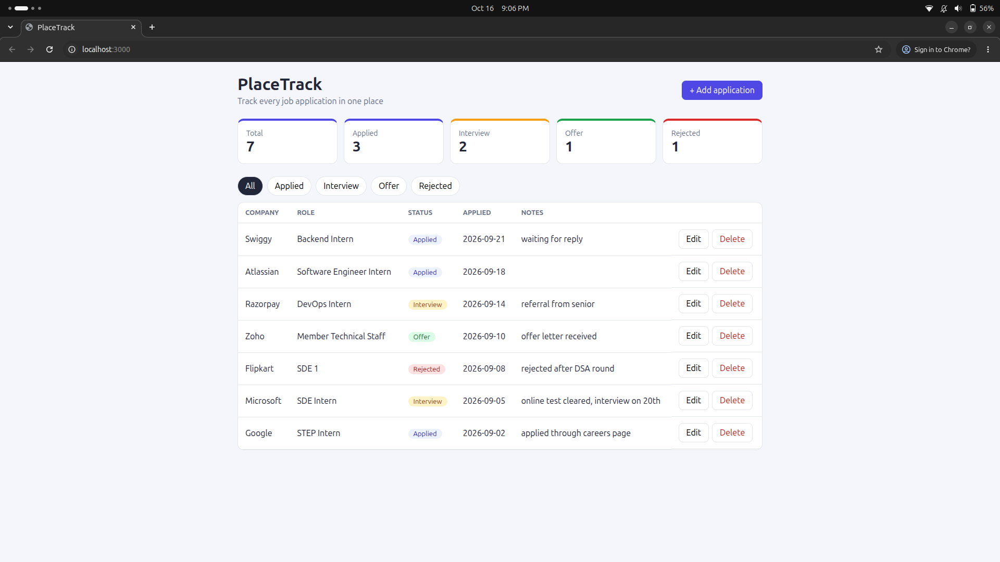

*The app running at localhost:3000 with some applications added.*

It also works on a small screen (the notes column is hidden on mobile so the table fits):

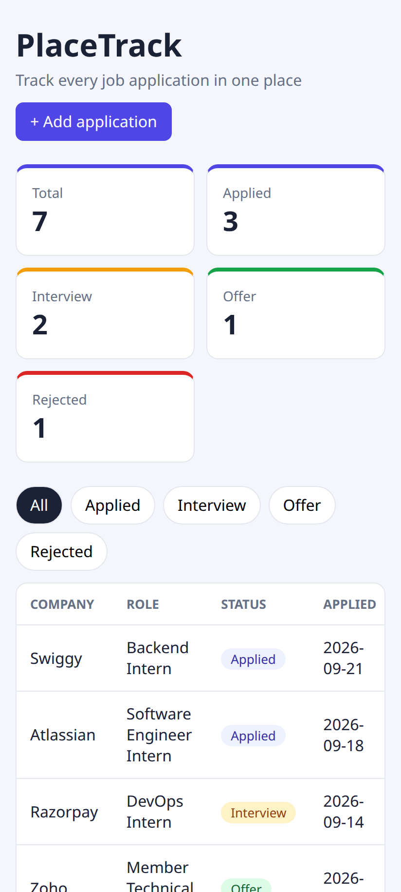

---

## M2 - Testing (pytest)

All tests are in `backend/tests/test_api.py`. There are **16 tests** and they cover all the endpoints:

- health and ready (and ready giving 503 when the database is down)
- create a job, and create with wrong status / blank company (should give 422)
- list jobs and filter by status
- get, update and delete a job, and the 404 case for each
- stats (empty and with data)
- `/metrics` endpoint

The tests **don't use the real Postgres database**. In `conftest.py` I make a new SQLite database in memory for every test and replace the `get_db` function with it. So every test starts with an empty database.
`pytest.ini` sets the test folder and python path.

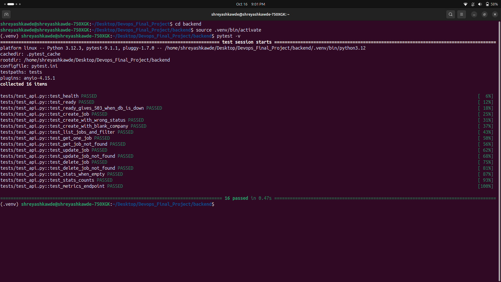

*All 16 tests passed.*

---

## M3 - Git and GitHub

Repo: https://github.com/Shreyash-Beyond-Journeys-End/Devops_Final_Project

I made small commits with clear messages (for example "Add Alembic migration to create the jobs table", "Add Trivy scan to fail the pipeline on HIGH and CRITICAL vulnerabilities").

My `.gitignore` ignores `.env`, `__pycache__/`, `.venv/`, `node_modules/`, `dist/`, terraform state files and `terraform.tfvars`.
No passwords or AWS keys are in the repo. AWS login comes from `aws configure` on my laptop, and the Kubernetes database password is generated when the helm chart is installed.

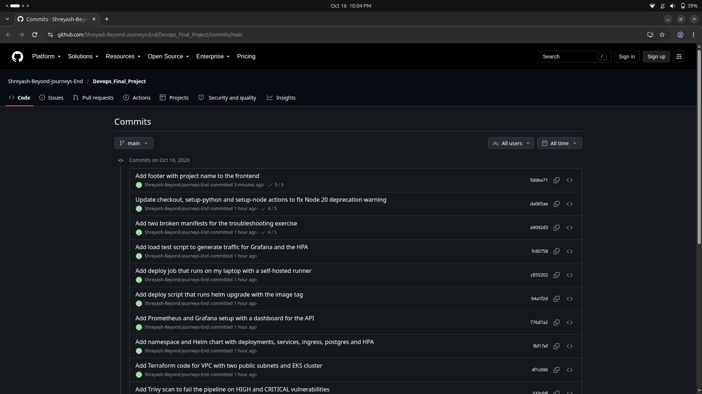

*Commit history on GitHub.*

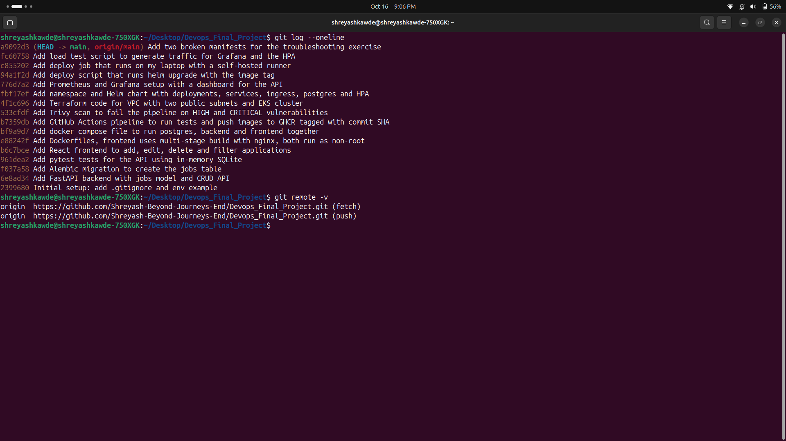

*Same history from `git log --oneline`.*

---

## M4 - Docker

**backend/Dockerfile**
- starts from `python:3.12-slim`
- installs requirements first (so docker caches that layer)
- creates a user `appuser` (uid 10001) and runs as that user, not root

**frontend/Dockerfile** (multi-stage)
- stage 1: `node:20-alpine` runs `npm run build`
- stage 2: only the built files are copied into `nginx-unprivileged`, which runs as user 101 (not root) on port 8080
- nginx serves the React files and sends `/api` requests to the backend

**docker-compose.yml** starts 3 services: `postgres`, `backend` and `frontend`.
The backend waits until postgres is healthy, runs the migration and then starts. The frontend is on port 3000.

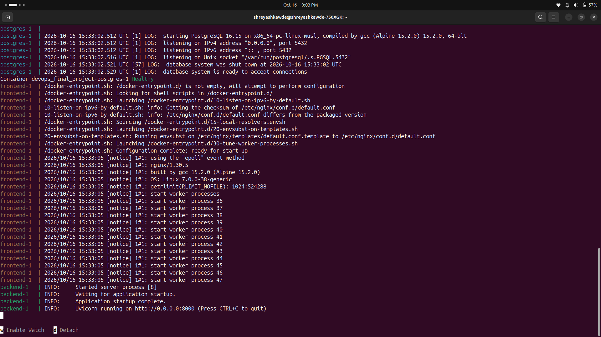

*`docker compose up --build`: postgres healthy, nginx started, uvicorn running.*

---

## M5 - CI/CD (GitHub Actions)

File: `.github/workflows/ci-cd.yml`. It runs on every push to `main` (and on pull requests, but those don't push images).

Jobs:

1. **test** - installs python packages and runs `pytest -v`. If any test fails, the pipeline stops here.
2. **frontend** - runs `npm ci` and `npm run build`.
3. **image** - runs only if both jobs above passed. Builds the backend and frontend images, scans them with Trivy, and pushes them to GHCR.
4. **deploy** - runs on a self-hosted runner on my laptop and does `helm upgrade` on minikube with the new image. It only runs if the repo variable `DEPLOY_ENABLED` is `true`, because my laptop is not always on.

Images are tagged with the **commit SHA**, not `latest`:

```
ghcr.io/shreyash-beyond-journeys-end/placetrack-backend:<commit sha>
ghcr.io/shreyash-beyond-journeys-end/placetrack-frontend:<commit sha>
```

This way I always know which commit is running.

Green pipeline run (all 5 jobs including deploy): https://github.com/Shreyash-Beyond-Journeys-End/Devops_Final_Project/actions/runs/38932552617

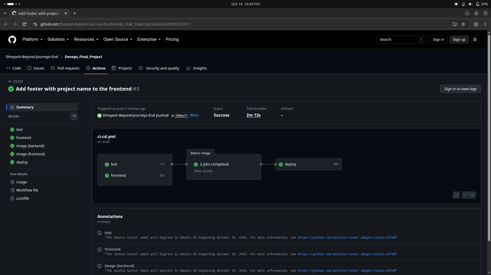

*Pipeline run #3: test, frontend, image (backend + frontend) and deploy are all green.*

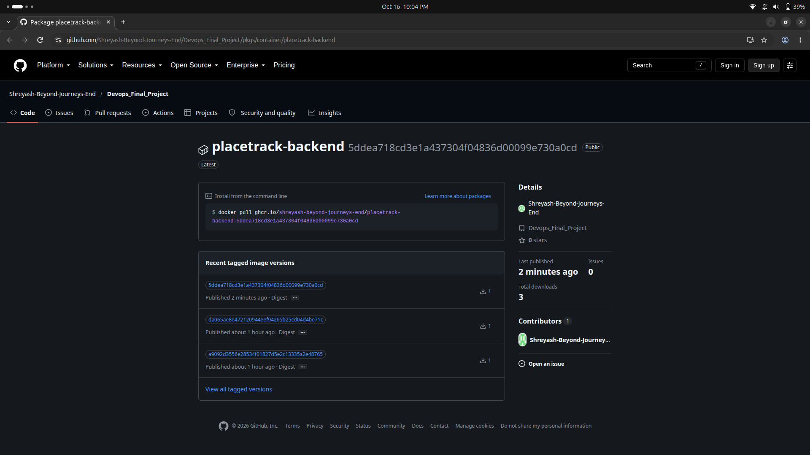

*Backend package on GHCR, every version is a commit SHA.*

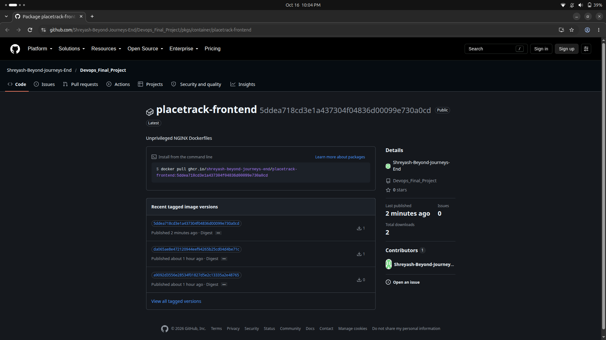

*Frontend package on GHCR.*

---

## M6 - Security scan (Trivy)

In the `image` job, after the image is built and **before it is pushed**, Trivy scans it.
It is set to `severity: HIGH,CRITICAL`, `ignore-unfixed: true` and `exit-code: 1`.
So if there is a HIGH or CRITICAL vulnerability that has a fix available, the job fails and the image is not pushed.

**What the result means:** Trivy checked the OS packages in both images (Debian 13.7 in the backend, Alpine 3.24.2 in the frontend) and all the Python packages in the backend. It found **0 HIGH or CRITICAL vulnerabilities** in both. That means there was no known serious problem on the day of the scan. New CVEs come out all the time, so that's why the scan runs on every build and not just once.

Note: the trivy action is pinned to a commit SHA and not a version tag, because in 2026 some trivy-action tags were hijacked. Pinning to a commit means nobody can change the code I run.

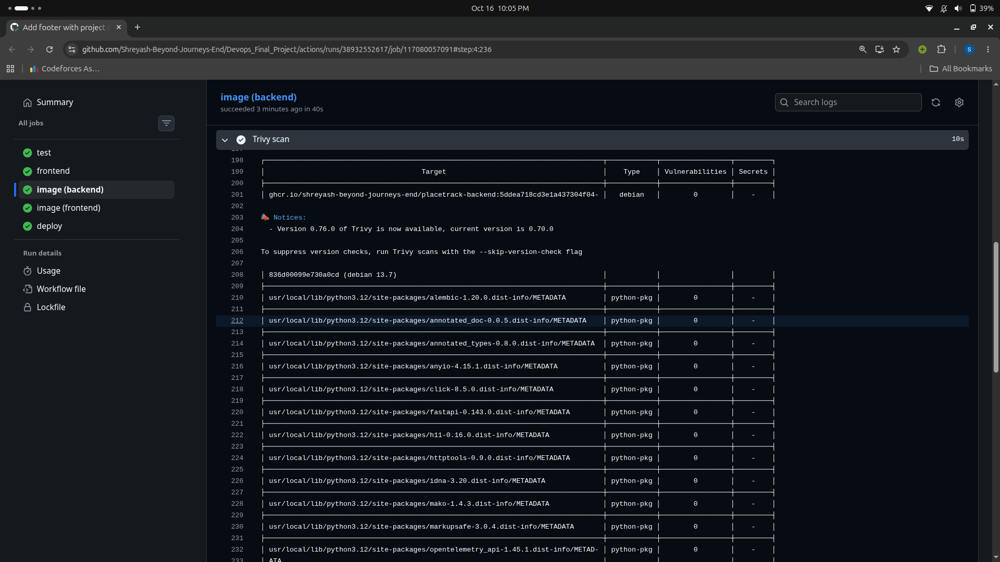

*Backend scan: debian and every python package show 0.*

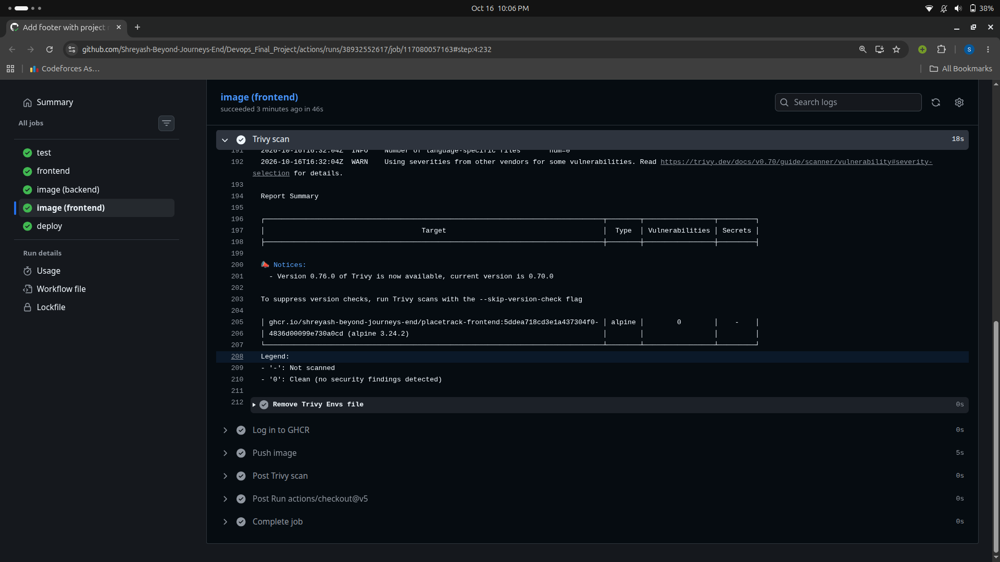

*Frontend scan: alpine 3.24.2 shows 0.*

---

## M7 - Terraform (AWS)

Files: `terraform/main.tf`, `variables.tf`, `outputs.tf`, `versions.tf`. Region is **ap-south-1 (Mumbai)**.

It creates:
- a **VPC** `10.0.0.0/16` with **2 public subnets** (`10.0.1.0/24`, `10.0.2.0/24`) in 2 availability zones
- an **EKS cluster** (Kubernetes 1.35) with **1 node group** of 2 `t3.small` nodes

Some choices I made:
- No NAT gateway, because it costs money every hour. So the nodes are in the public subnets.
- `t3.small` because my AWS account doesn't allow `t3.medium`.
- The EKS API can only be reached from my own IP (`api_access_cidrs`).
- `terraform.tfvars.example` is in the repo, my real `terraform.tfvars` is not (it is in `.gitignore`).

```bash
cd terraform
cp terraform.tfvars.example terraform.tfvars   # put your own ip
terraform init
terraform plan -out=tfplan
terraform apply tfplan
terraform destroy
```

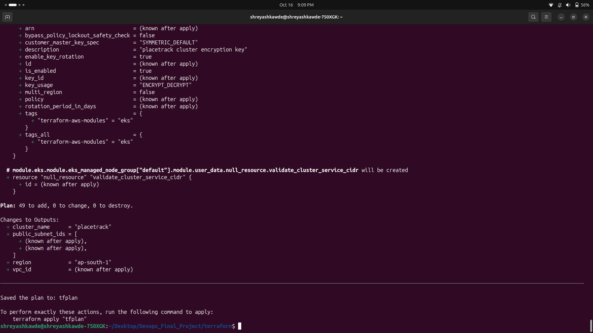

*`terraform plan`: 49 to add, 0 to change, 0 to destroy.*

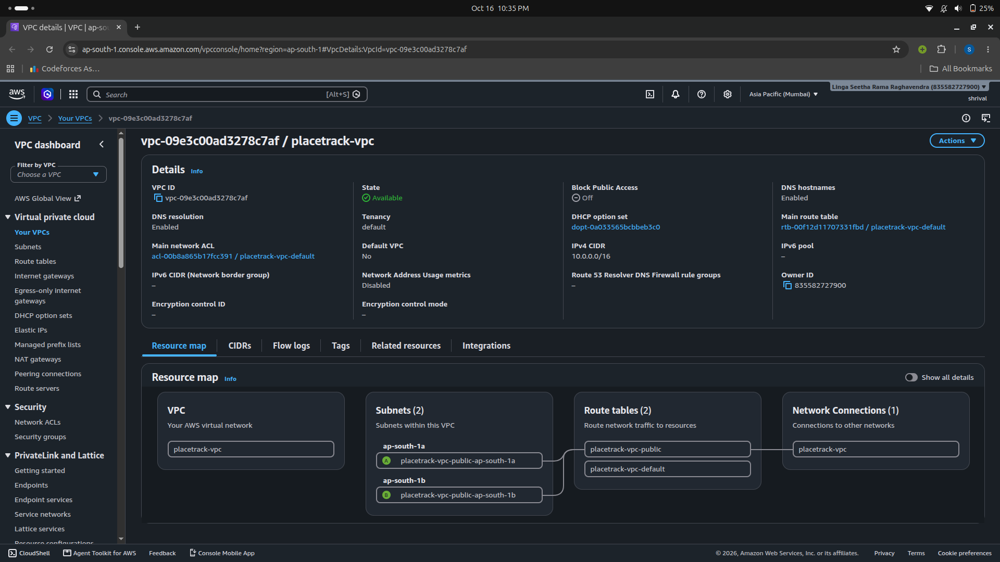

*The VPC `placetrack-vpc` in the AWS console with its 2 public subnets.*

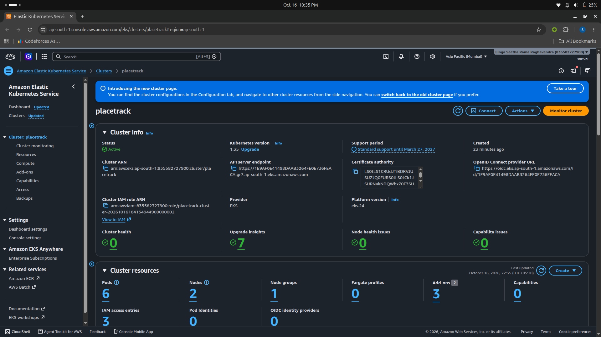

*EKS cluster `placetrack` is Active.*

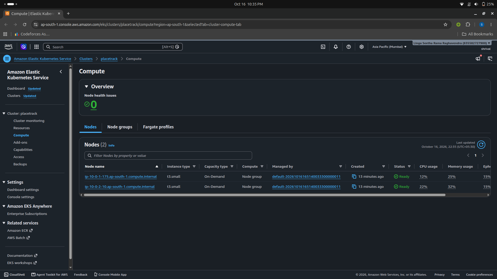

*The node group with 2 `t3.small` nodes.*

EKS costs money every hour, so I deleted everything after taking the screenshots:

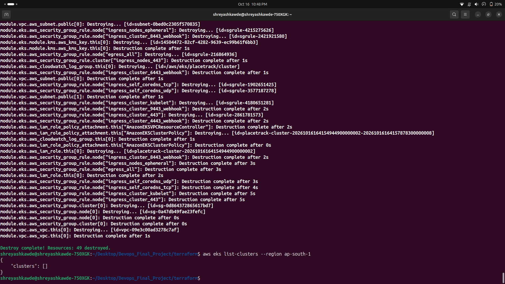

*`terraform destroy`: all 49 resources destroyed.*

---

## M8 - Kubernetes + Helm

I ran the app on **minikube** on my laptop (to save AWS money), using the images from GHCR.

`k8s/namespace.yaml` creates the `placetrack` namespace.

Helm chart `helm/placetrack/` has `Chart.yaml`, `values.yaml` and these templates:

| File | What it makes |
|---|---|
| `backend.yaml` | backend Deployment (2 replicas) + ClusterIP Service |
| `frontend.yaml` | frontend Deployment (2 replicas) + ClusterIP Service |
| `postgres.yaml` | Postgres StatefulSet with 1Gi storage |
| `secret.yaml` | random database password, made on first install |
| `migrate-job.yaml` | Job that runs `alembic upgrade head` after every install/upgrade |
| `ingress.yaml` | `placetrack.local`: `/` goes to frontend, `/api` goes to backend |
| `hpa.yaml` | autoscaling for the backend (2 to 4 pods at 60% CPU) |
| `servicemonitor.yaml` | tells Prometheus to scrape the backend (see M9) |

Pods run as non-root in the cluster too (`runAsNonRoot`). The backend has a readiness probe on `/ready` and a liveness probe on `/health`.

Commands I used:

```bash
minikube start --driver=docker --cpus=4 --memory=5500
minikube addons enable ingress
minikube addons enable metrics-server
echo "$(minikube ip) placetrack.local" | sudo tee -a /etc/hosts
./scripts/deploy.sh <commit sha>     # applies namespace + helm upgrade --install
```

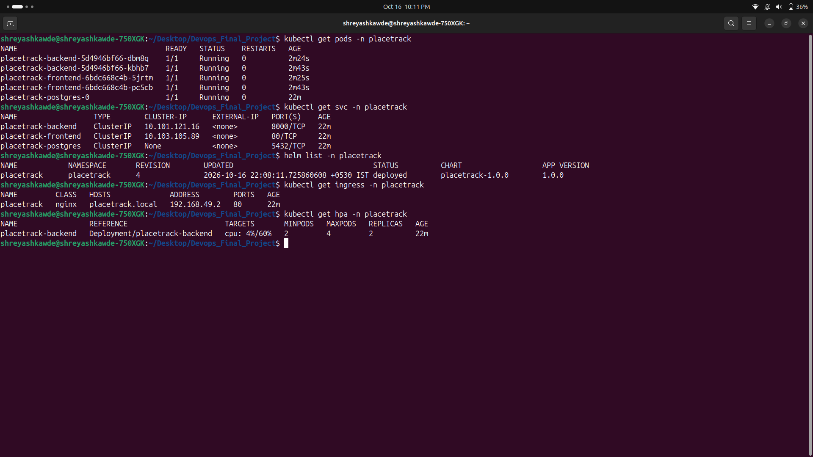

*`kubectl get pods` (all Running), `kubectl get svc` (ClusterIP), `helm list`, ingress and hpa.*

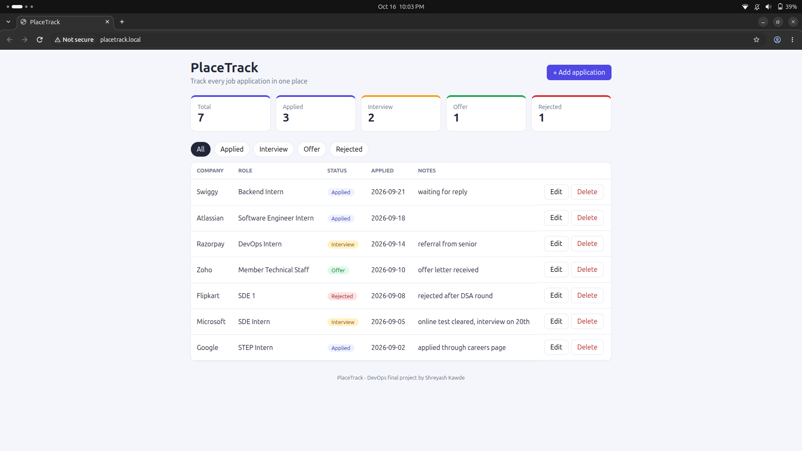

*The app opened through the ingress at http://placetrack.local.*

**Autoscaling test:** I ran `scripts/load-test.sh` a few times at once. CPU went to 148% of the request, and the HPA scaled the backend from 2 to 4 pods.

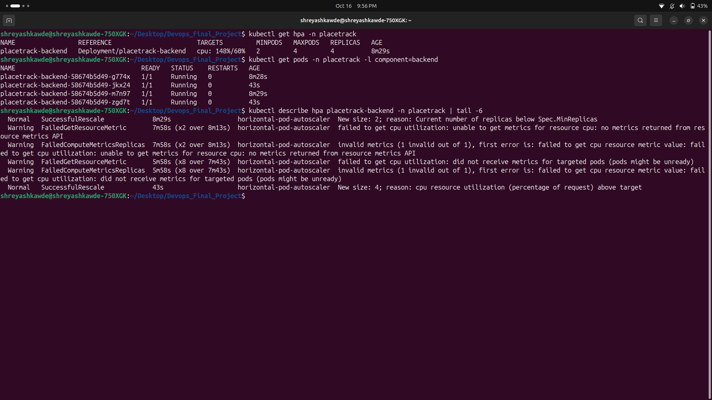

*HPA at 148%/60% with 4 replicas, and the `SuccessfulRescale` event "New size: 4".*

---

## M9 - Monitoring (Prometheus + Grafana)

The backend has a `/metrics` endpoint (made with `prometheus-fastapi-instrumentator`). It gives the request count and request time for each endpoint.

`monitoring/install.sh` installs the **kube-prometheus-stack** helm chart with `monitoring/values.yaml` and loads my dashboard `monitoring/grafana-dashboard.json`.
In the values file I made Prometheus read ServiceMonitors from all namespaces, kept data for only 6 hours (small laptop), and turned off Alertmanager.
The Grafana password is random and stored in a Kubernetes secret, not in git.

```bash
./monitoring/install.sh
helm upgrade placetrack helm/placetrack -n placetrack --reuse-values --set serviceMonitor.enabled=true
./scripts/load-test.sh http://placetrack.local 300
```

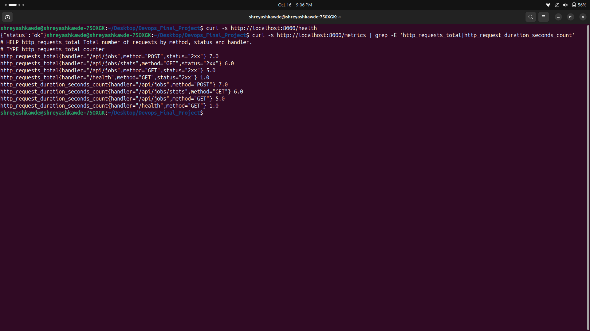

*`curl http://localhost:8000/metrics` showing the request counters.*

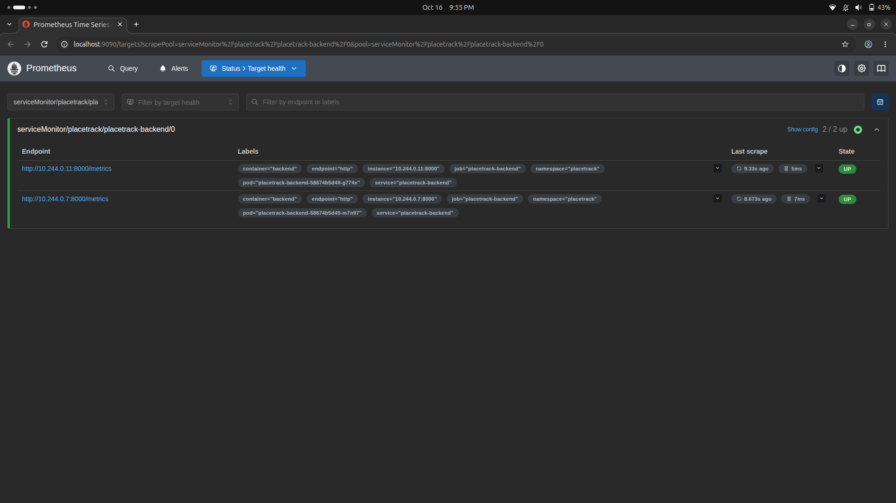

*Prometheus target `serviceMonitor/placetrack/placetrack-backend/0`: both backend pods are UP.*

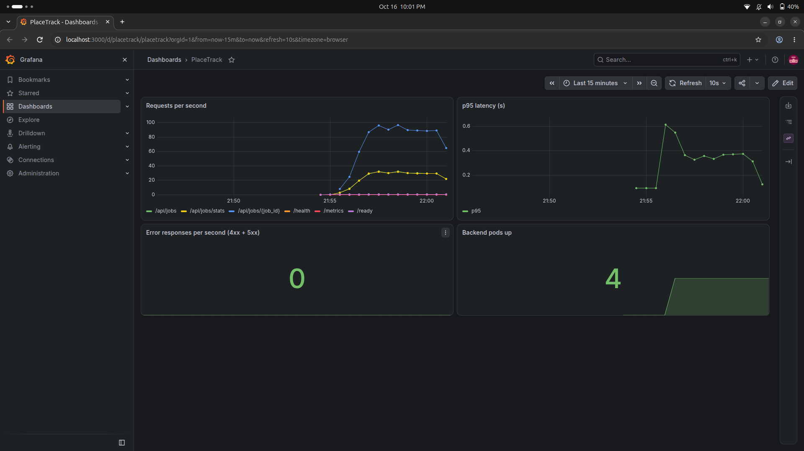

*My Grafana dashboard during the load test: requests per second, p95 latency, errors (0) and backend pods up (4, because the HPA scaled up).*

---

## Troubleshooting practice

I broke 2 things on purpose and fixed them (full steps in [troubleshooting/README.md](troubleshooting/README.md)):

1. **Wrong image tag** - pod stuck in `ImagePullBackOff`. `kubectl describe pod` showed the tag was not found in GHCR. Fixed by setting a real commit SHA tag.
2. **Wrong service selector** - pod was Running but the service had no endpoints. The selector was `app=tb-service` but the pod label was `app=tb-svc`. Fixed by patching the selector.

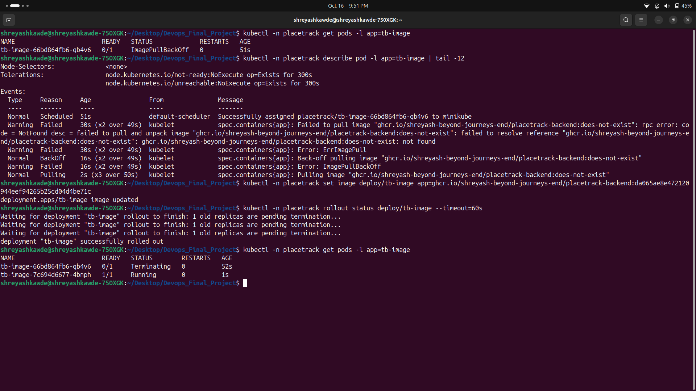

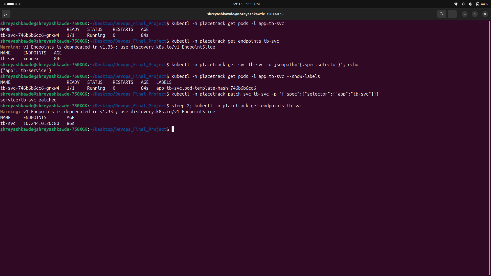

---

## M10 - Live demo

Demo plan: change the app, push, and watch it get deployed automatically.

Before the demo: minikube is running, the self-hosted runner is started (`cd ~/actions-runner && ./run.sh`) and `DEPLOY_ENABLED` is `true`.

1. Open http://placetrack.local
2. Make a small change in `frontend/src/App.jsx`, then `git commit` and `git push`
3. Open the Actions tab and watch test -> frontend -> image -> deploy
4. In a terminal run `kubectl get pods -n placetrack -w` to see new pods come up and old ones stop
5. Refresh the browser and the change is there

I tried this before the presentation: I added a footer to the page and pushed it. The pipeline built and scanned the new images, the deploy job ran `helm upgrade` on my laptop, and the pods were replaced:

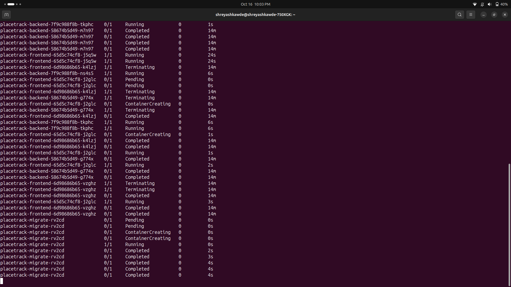

*`kubectl get pods -w` during the deploy: new pods Running, old pods Terminating, migration job Completed.*

---

## Problems I faced

- **nginx 502 error in Kubernetes:** nginx could not find the backend using the short service name. I had to use the full name `placetrack-backend.placetrack.svc.cluster.local`.
- **Pods Running but not Ready:** the backend pods stayed 0/1 until Postgres was ready, because `/ready` checks the database. That is actually what I wanted.
- **Database password after reinstall:** the Postgres volume keeps the old password, so I made the secret stay after `helm uninstall` and reuse the old password on upgrade.
- **GitHub Actions warning:** older action versions use Node 20, which is deprecated. I updated them to newer versions.
- **HPA not scaling at first:** one load test was not enough to reach 60% CPU, so I ran a few at the same time.
- **AWS cost:** I only kept EKS running for the screenshots and then ran `terraform destroy`.

## What I learned

- A build that works can still have security problems, so scanning every image is important.
- Tagging images with the commit SHA makes it easy to know what is running and to roll back.
- Readiness and liveness probes are different things.
- Helm makes it easy to change one value (like the image tag) and redeploy.
- Cloud resources cost money even when you are not using them, so always destroy them.

## What I would add next

- Deploy the Helm chart on the EKS cluster too, not only minikube
- Turn on Alertmanager with an alert when error rate is high
- Run the tests against real Postgres in CI so the migration is also tested
